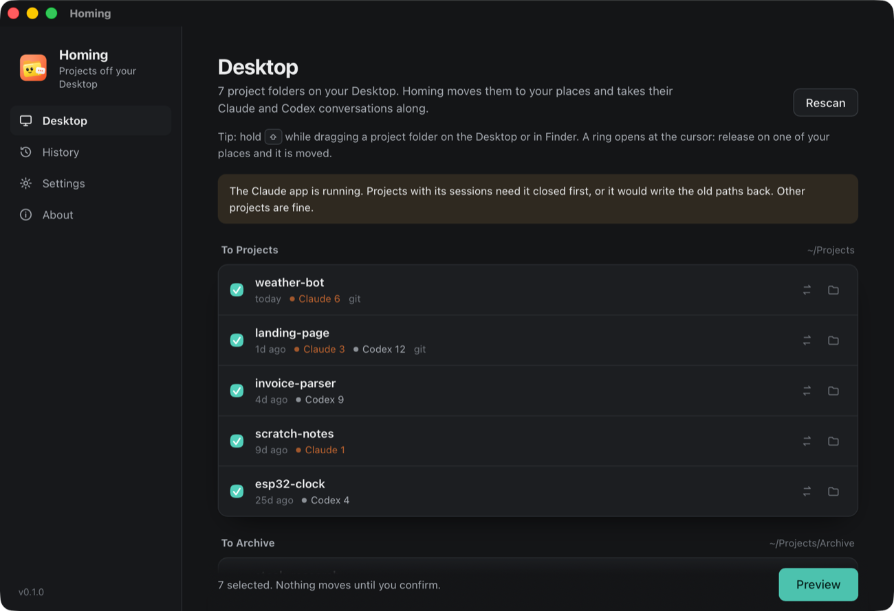
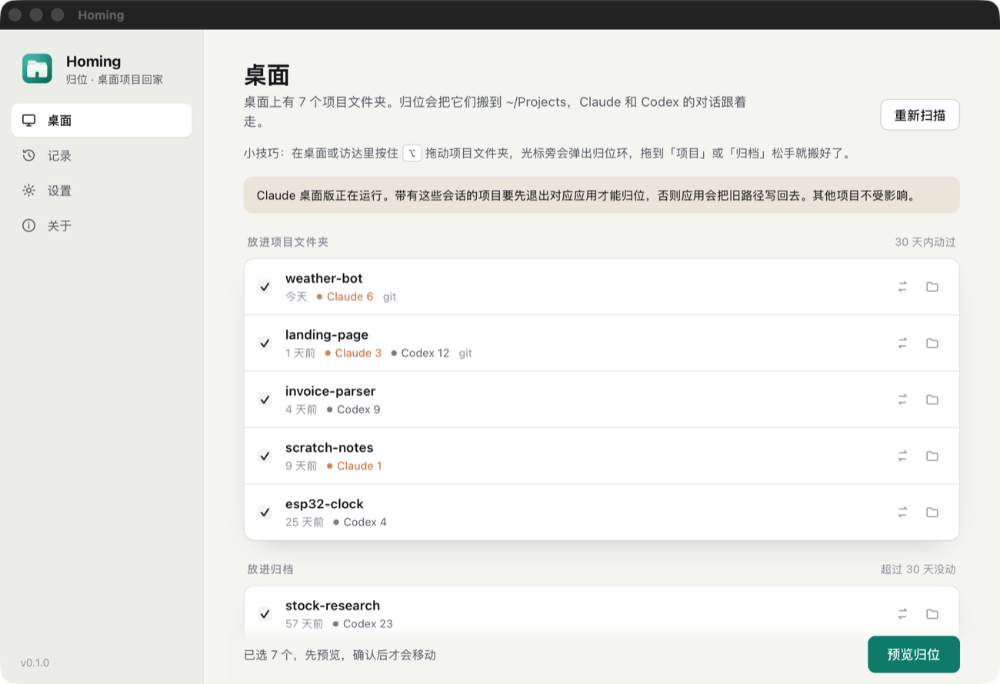

<p align="center">
  
</p>

<h1 align="center">Homing</h1>

<p align="center"><i>中文名：归位</i></p>

<p align="center"><b>Get AI-agent projects off your Desktop without losing a single conversation.</b><br>
Homing moves project folders from your Desktop into one place and updates Claude Code, the Claude desktop app and Codex so every session still resumes. Offline, previewed first, and every move can be undone. For macOS and Windows.</p>

<p align="center"><a href="#中文说明">中文说明</a></p>



*Sample projects, all fictional.*

## Why

Coding agents make starting a project nearly free. Ask Claude Code or Codex for something new, and a new folder appears, usually on the Desktop. A few weeks later the Desktop holds twenty half-finished projects.

Cleaning up should be easy: drag them into a `Projects` folder. But agents remember projects by absolute path. Move a folder and Claude Code's `--continue` and `/resume` come up empty, the Claude app's sessions point at a folder that no longer exists, and Codex files the conversations under a project that is gone. Many people have reported this ([#37954](https://github.com/anthropics/claude-code/issues/37954), [#33634](https://github.com/anthropics/claude-code/issues/33634), [#27473](https://github.com/anthropics/claude-code/issues/27473), [#41344](https://github.com/anthropics/claude-code/issues/41344)). Today the official workarounds are to move the folder back or leave a symlink behind. Desktop organizers such as Hazel or Spotless move folders blindly and break the same links.

Homing is the move that keeps the links.

## What it does

- **Hold ⌃ and drag (macOS).** Drag a project folder from the Desktop or Finder, press ⌃, and a ring opens under the cursor: **Projects**, **Archive** and **Preview**. Release on one and the folder is moved, sessions included, with **Undo** right in the middle of the ring. Release in the middle to cancel. No Accessibility permission needed; Homing waits in the menu bar.
- **Your keys, no clashes.** Record any combination of ⌃ ⌥ ⇧ ⌘ in Settings. The ring opens only for exactly those keys, and Homing reads the drag gestures of [Filee](https://github.com/KnifeLemon/Filee) (⌘) and [Peekless](https://github.com/DerrickDaVinci/peekless) (⌥) on your machine and warns you if your choice would open theirs too.
- **One list, one button.** Open Homing and see every project folder on your Desktop: when you last touched it and how many Claude and Codex sessions belong to it. Active projects go to `~/Projects`, ones untouched for 30 days go to `~/Projects/Archive`. Press **Preview**, then **Move**.
- **Drop any folder** on the window to preview moving just that one.
- **Agents follow the folder.** Homing rewrites the stored paths so sessions resume from the new location.
- **Preview first, undo always.** In the window nothing moves until you confirm the preview; with the ring, releasing on a destination is the confirmation (switch it to *Preview first* in Settings if you prefer). Every move is listed in History with an **Undo** that puts the folder and all session records back.
- **Refuses unsafe moves.** If a terminal, agent or dev server is running inside the folder, or if Claude or Codex is open and holds that project's sessions in memory, Homing tells you to close it first instead of racing it.

### What gets updated

| Agent | What Homing changes |
|---|---|
| Claude Code (CLI and IDE) | Renames `~/.claude/projects/<encoded path>/` (memory included) and the working-directory paths in every transcript, subagent transcripts too |
| Claude desktop app | The session files under `Claude/claude-code-sessions/` whose working directory is the project, plus its worktree and preset indexes |
| Codex (desktop app and CLI) | `threads` and `project_roots` in `state_N.sqlite`, the rollout files of those threads (`.jsonl` and `.jsonl.zst`), `config.toml` trust entries and automations |
| Git | Runs `git worktree repair` when the project has linked worktrees |

Only JSON and TOML string values that **start with** the old path are rewritten. A conversation that merely mentions the path in prose is left alone. Because the rewrite is its own inverse, undo is simply the same move in reverse.

## Safety

- **Nothing moves by accident.** The window and the CLI only move after you confirm a preview (`--apply`); the ring moves when you release on a destination, and keeps Undo there and in the menu bar.
- **Backups.** Before each move Homing copies the small index files it is about to change (the Codex database, the Claude app's session files, `config.toml`) to `~/Library/Application Support/app.homing.desktop/backups` (`%APPDATA%` on Windows). The last 10 are kept. Transcripts are not copied, because they can be gigabytes. They are replaced atomically and are restored by Undo.
- **Never deletes.** Folders are moved with a single rename on the same disk. Moves across disks are refused.
- **No network, no telemetry, no account.**

## Install

Download the latest installer from [Releases](../../releases).

- **macOS 13+:** download `_aarch64.dmg` for Apple silicon or `_x64.dmg` for Intel and drag Homing to Applications. The app is not notarized yet, so the first launch is blocked once: open **System Settings → Privacy & Security** and click **Open Anyway** next to Homing. macOS then asks once whether Homing may access your Desktop. It needs that to list and move your projects.
- **Windows 10/11:** run the `.msi` or `-setup.exe`. If SmartScreen appears, click **More info → Run anyway**.

## Command line

The app binary is also a CLI, handy for letting an agent tidy up after itself:

```bash
homing scan                                # Desktop projects and their sessions
homing move ~/Desktop/my-app               # preview the move to ~/Projects
homing move ~/Desktop/my-app --apply       # do it
homing move ~/Desktop/old --to ~/Projects/Archive --apply
homing undo                                # put the last move back
```

On macOS the binary is at `/Applications/Homing.app/Contents/MacOS/homing`.

## Limits

- Homing relies on how Claude Code, the Claude app and Codex store their data today. None of it is a documented format, and a future version could change it. Homing reads defensively: if it cannot recognize something, it leaves it alone and counts nothing.
- Close the Claude app and Codex before moving projects that have their sessions. Homing checks this and tells you.
- Python virtual environments (`.venv`) store absolute paths and must be recreated after a move. Homing warns you when it sees one.
- Per-project settings in `~/.claude.json` (allowed tools, the "trust this folder" answer) are not moved, because running Claude Code processes rewrite that file constantly. Claude asks to trust the folder again the first time you open it.
- Windows support is built and unit-tested in CI but has not been tried on a real Windows machine yet.

## Build from source

Requirements: [Rust](https://rustup.rs), Node.js 18+, and on macOS the Xcode Command Line Tools.

```bash
npm install
npm run dev        # run the app
npm run build      # build installers into src-tauri/target/release/bundle
cd src-tauri && cargo test
```

The UI is plain HTML, CSS and JS in `ui/` with no build step. Open `ui/index.html` in a browser to work on it: `ui/preview-mock.js` fakes the backend with sample data.

## Roadmap

- The homing ring on Windows (today Windows users drop folders on the window)
- Agent scratch folders outside the Desktop (`~/Documents/Codex/<date>/task`, the Claude app's scratch workspaces)
- More agents: Cursor, Gemini CLI, OpenCode
- Show reclaimable build caches (`node_modules`, `target`) per project

## License

[MIT](LICENSE)

---

## 中文说明

**归位（Homing）：把 AI 代理开的项目从桌面搬走，对话记录一条不丢。**

用 Claude Code、Codex 开发时，每个新想法都会变成桌面上的一个新文件夹，没多久桌面就堆了二十几个项目。想把它们拖进一个 `Projects` 文件夹整理一下，问题来了：代理是按绝对路径记住项目的，文件夹一挪，Claude Code 的 `--continue` 和 `/resume` 就找不到之前的对话，Claude 桌面版和 Codex 里的会话也会指向一个不存在的文件夹。Hazel、Spotless 这类整理工具同样会把这些关联弄断。

归位做的就是"挪文件夹，但不断关联"：

- **按住 ⌃ 拖动（macOS）**：从桌面或访达拖动项目文件夹时按住 ⌃，光标旁会弹出归位环，三格分别是【项目】【归档】【预览】。拖到一格松手就搬好了，会话一起带走，环中间留着【撤销】。拖到中间松手即取消。不需要辅助功能权限，Homing 平时待在菜单栏。
- **按键自己定，不和别的工具抢**：在设置里录制任意 ⌃ ⌥ ⇧ ⌘ 组合，只有正好按着这组键才会弹出归位环。Homing 会读取你电脑上 Filee（⌘）和遮遮（⌥）的拖动手势设置，如果你选的组合会让它们的环也一起弹出，会提前提醒你。
- **一个列表，一个按钮**：打开就能看到桌面上所有项目文件夹，每个项目最近什么时候动过、有多少 Claude 和 Codex 会话。最近 30 天动过的放进 `~/Projects`，更久没动的放进 `~/Projects/Archive`。点【预览归位】，确认后点【归位】。
- **拖进窗口**：任何文件夹拖进来，就只预览和处理这一个。
- **会话跟着走**：自动更新 Claude Code、Claude 桌面版和 Codex 里记录的路径，在新位置照样能续上对话。只改路径，不改对话内容。
- **先预览，随时撤销**：在窗口里，确认之前什么都不会动；用归位环时，拖到目标松手就是确认（也可以在设置里改成"先预览"）。菜单栏里随时可以"撤销上一次归位"。每次归位都记在【记录】里，撤销会把文件夹和会话记录一起放回原处。
- **不冒险**：文件夹里有终端、代理或开发服务器在运行，或者 Claude、Codex 开着并且持有这个项目的会话，归位会提示你先关掉，而不是跟它们抢着写文件。

**安装**：到 [Releases](../../releases) 下载。Apple 芯片的 Mac 选 `_aarch64.dmg`，Intel 的 Mac 选 `_x64.dmg`，Windows 选 `_x64-setup.exe`。应用还没有经过 Apple 公证，Mac 上第一次打开会被拦一次：打开**系统设置 → 隐私与安全性**，点归位旁边的**仍要打开**。之后系统会问一次是否允许归位访问"桌面"文件夹，选允许，它才能列出和移动你的项目。

**命令行**：`homing scan` 查看桌面项目，`homing move <文件夹>` 预览，加上 `--apply` 才真正移动，`homing undo` 撤销上一次。

**隐私**：不联网，不上传，没有任何统计。


